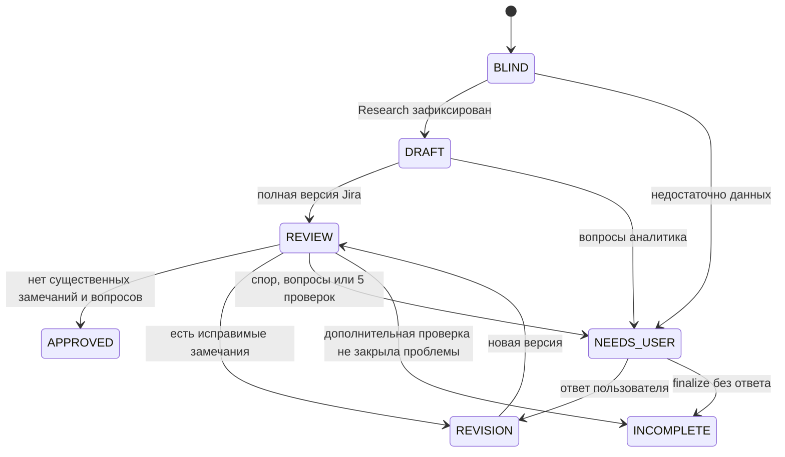

# Устройство координатора

`inputs.py` фиксирует явные первоисточники и версии репозиториев. `models.py` задаёт строгие JSON-схемы Research, Draft, Review и Finding; дополнительные поля и неверные типы отвергаются. `pipeline.py` выполняет переходы, не принимает продуктовых решений за агентов. `sdk_adapter.py` использует публичные методы официального SDK; stdout CLI не разбирается.

## Независимость

Ревьюер создаётся первым и возвращает Research. Проверенный ответ и checkpoint записываются до создания Thread аналитика. Аналитик получает исходники и решения пользователя; собственные выводы ревьюера ему не передаются. После Draft ревьюер продолжает свой исходный Thread и получает версию документа. Каждая версия проверяется отдельно; ранее незакрытое замечание нельзя молча убрать из следующего Review.

До создания аналитика `resume --continue-research` может продолжить остановленное исследование в том же Thread ревьюера, максимум два раза. Счётчик `research_round` совместим со старыми состояниями (по умолчанию 0); ответы и вопросы каждого прохода имеют собственные имена. Уточнения пользователя и лимит 5+1 этим режимом не изменяются. При возобновлении `FAILED` активная стадия сохраняется до модельного вызова, поэтому `status` отражает выполняемую работу.

Разные истории дополняются физическим барьером Linux bubblewrap: SDK app-server работает в пустом файловом представлении с явными read-only mounts. Доступны системные программы, первоисточники из manifest, проектные инструкции, репозитории и текущая Wiki. Остальные тематические файлы, `.agent/`, runtime других прогонов и глобальные истории Codex отсутствуют. Каждая роль имеет отдельный постоянный CODEX_HOME для своих Thread. Модельные инструменты дополнительно ограничены `Sandbox.read_only`, `ApprovalMode.deny_all`; веб-поиск и самостоятельные подагенты выключены. Невозможность создать view останавливает запуск; автоматического ослабления изоляции нет.

Авторизация существующего ChatGPT-аккаунта подключается runtime через read-only mount auth-файла; строитель его не читает, не копирует и не изменяет. Обновление авторизации выполняет пользователь вне системы. Ограничение: auth текущей роли технически доступна её процессу; эта реализация не является отдельным брокером учётных данных. Инструкции запрещают агентам читать секреты. Чужие auth-сессии и глобальные базы не подключаются.

Публичные системные TLS trust stores подключаются вместе с целями их symlink: одного `/etc/ssl/certs` недостаточно на всех дистрибутивах. Из окружения передаётся узкий список proxy/CA настроек, остальные переменные не наследуются. `doctor` проверяет загрузку доверенных CA внутри самого изолированного представления без сети и авторизации. Команда запуска каждой роли сохраняется неизменяемым файлом с SHA256 содержимого в имени; исправленная политика при resume получает новый файл, прежние версии сохраняются.

## Переходы

Уточнения до первого ревью не расходуют дополнительный цикл. После эскалации на стадии ревью доступен один дополнительный цикл по ответу пользователя; максимум 6 проверок всего. Повтор той же проблемы без новой ссылки/версии/символа передаётся пользователю раньше лимита. Перефразирование наблюдения новым свидетельством не считается. Координатор сравнивает ссылки; смысловую достаточность доказательств оценивает ревьюер.

Несогласованность раздела «Открытые вопросы» с пустыми структурированными questions считается ошибкой формата: аналитик обязан вернуть реальные вопросы либо корректно описать уже определённые зависимости. Предыдущая версия не согласуется; исправление проверяется новым Review и расходует обычный цикл. Старое NEEDS_USER можно так возобновить только при точном совпадении вопросов с извлечённым разделом, без других существенных замечаний, до пятого ревью и без использования дополнительного цикла. История и ответы пользователя сохраняются.

## Запись, сбои и перенос

Только координатор пишет в `.private/runtime/<run-id>/`. Файловый шлюз проверяет канонические пути, запрещает репозитории, использует directory descriptors, `O_NOFOLLOW`, атомарную фиксацию, запрет перезаписи версий и блокировку одного прогона. Экспорт разрешён отдельно только в исходную тематическую папку и после проверки содержимого пользователем. Файлы прошлых прогонов не удаляются.

`state.json` содержит schema version, Thread IDs, стадию, версии документов, счётчики, ответы и историю ревью. `responses/` — неизменяемые структурированные ответы; `results/` — Jira текст; `questions/` — вопросы. Ошибки провайдера сохраняются только как тип, без потенциально чувствительных ответов/трассировок. Auth, лимит аккаунта, сеть, формат ответа и deadline приводят к сохранению checkpoint; `resume` продолжает сохранённые Thread. Завершённый ответ из responses повторно не запрашивается. При аварии между сетевым ответом и записью локального файла повторный запрос возможен; строго однократное выполнение сетевых операций не обещается.

При восстановлении `OutputLimitExceeded` на DRAFT/REVISION включается `segmented_draft`: тот же аналитик возвращает до 40 завершённых `DraftPart` с последовательными индексами и признаком продолжения. Каждая часть проходит проверку схемы, свидетельств и версий источников и сохраняется через обычный шлюз. Координатор собирает полный `Draft` (до 500 000 символов, общий JSON до 2 MB), не интерпретируя содержание и не теряя разных свидетельств. До сборки версия и число ревью не меняются; ревьюер получает полный документ. Кэш частей позволяет продолжать после сбоя. Слепая стадия, два Thread и ограничение 5+1 не меняются.

SDK сохраняет rollout после первого turn. Пустой Thread, созданный перед аварией, может вернуть точный typed ответ `no rollout found`; только если роль ещё не вернула ни одного результата, координатор создаёт замену с новым ID и фиксирует это событие. Сессия с результатами такой замене не подлежит.

Первоисточники и HEAD проверяются до и после модельных вызовов; изменение требует нового прогона. Исходные репозитории не обновляются и не собираются системой. На другом компьютере нужны Linux, Python 3.11+, bubblewrap, зависимости из requirements.txt и собственная авторизация Codex. Код и Wiki восстанавливаются отдельно от публичного Git.

Публичные методы сверены с установленным пакетом и [официальной документацией Codex SDK](https://learn.chatgpt.com/docs/codex-sdk). Автообнаружение ролей описано в [документации subagents](https://learn.chatgpt.com/docs/agent-configuration/subagents); TOML не заменяет явную установку прав через SDK.
